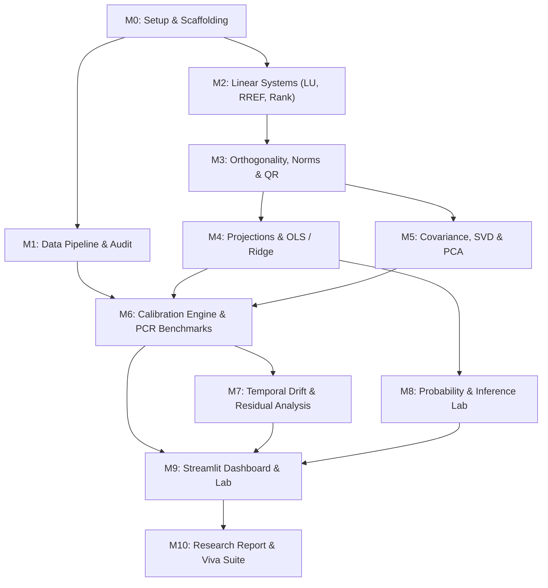

# AirSense: Implementation Plan & Academic Milestone Roadmap

## 1. Architectural Philosophy & Design Principles

AirSense is engineered with a strict **two-tier architecture**:
1. **Mathematical Core (`airsense.math`)**: Written in pure NumPy/SciPy primitives to expose every step of the matrix algebra, numerical decompositions, projection operators, and spectral algorithms. Each algorithm is paired with unit tests that verify mathematical invariants (e.g., orthogonality $Q^T Q = I$, idempotence $P^2 = P$, spectral reconstruction $V \Lambda V^T = S$).
2. **Scientific Engineering & Research Layer (`airsense.data`, `airsense.models`, `airsense.drift`, `airsense.experiments`)**: Production-grade data processing pipelines, zero-leakage chronological splitters, benchmark comparisons with `scikit-learn` / `scipy.linalg`, and diagnostic monitoring tools.
3. **Interactive Demonstration Layer (`airsense.ui`)**: A Streamlit application providing interactive matrix exploration, viva explanation walkthroughs (Concept $\to$ Purpose $\to$ Outcome), and real-time drift tracking.

---

## 2. Milestone Breakdown & Dependency Graph



---

## 3. Detailed Milestone Specifications

### Milestone 0: Environment Setup, Scaffolding & Packaging
- **Goal**: Initialize reproducible project environment, packaging configuration, pre-commit hooks, and pytest suite.
- **Dependencies**: None.
- **Files to Create/Configure**:
  - `pyproject.toml` (standard packaging configuration, metadata, dependencies)
  - `requirements.txt` / `requirements-dev.txt`
  - `.gitignore` (ignoring `.venv`, `__pycache__`, raw data, caches)
  - `src/airsense/__init__.py`
  - `tests/__init__.py`, `tests/conftest.py` (shared fixtures, synthetic matrices)
- **Deliverables**: Working Python virtual environment with all dependencies installable via `pip install -e .`, green test runner.
- **Acceptance Criteria**: `pytest` runs and passes baseline environment check; directory structure matches specification.

---

### Milestone 1: Raw Data Acquisition, Ingestion & Leakage-Free Preprocessing
- **Goal**: Safely download and parse the UCI Air Quality dataset, audit missingness patterns, enforce chronological partitions, and build leakage-free transformers.
- **Mathematical Focus**: Matrix representation $X \in \mathbb{R}^{n \times d}$, affine design matrix augmentation $[\mathbf{1} \mid X]$, data standardization as diagonal transformation.
- **Dependencies**: Milestone 0.
- **Files to Create**:
  - `src/airsense/data/download.py`: Script to download UCI Air Quality zip and extract `AirQualityUCI.csv`.
  - `src/airsense/data/loader.py`: Robust CSV reader handling semicolon delimiters, European comma decimals, empty trailing columns, timestamp parsing.
  - `src/airsense/data/preprocessor.py`: Chronological split generator (60% Train, 20% Val, 20% Test), `-200` sentinel replacement, missing value auditor, training-only fitted median/iterative imputer and standardizer ($Z = (X - \mu) \oslash \sigma$).
  - `tests/test_data_loader.py`: Tests for parsing, missing value handling, column selection.
  - `tests/test_preprocessor.py`: Tests verifying zero test leakage (mean and variance strictly from training set).
- **Deliverables**:
  - Cleaned, chronologically split datasets: $(X_{\text{train}}, y_{\text{train}})$, $(X_{\text{val}}, y_{\text{val}})$, $(X_{\text{test}}, y_{\text{test}})$.
  - Missingness profile report (audit of `-200` locations across features and target).
- **Acceptance Criteria**:
  - All reference analyzer columns ending in `(GT)` excluded from input features except target `C6H6(GT)`.
  - Exactly 8 sensor features retained: `PT08.S1(CO)`, `PT08.S2(NMHC)`, `PT08.S3(NOx)`, `PT08.S4(NO2)`, `PT08.S5(O3)`, `T`, `RH`, `AH`.
  - Preprocessing parameters strictly fitted on $X_{\text{train}}$. Test set never informs scaling.

---

### Milestone 2: Linear Systems, Elimination, RREF, LU Decomposition & Subspaces
- **Goal**: Implement Gaussian elimination, Reduced Row Echelon Form (RREF), LU factorization with partial pivoting, and compute fundamental subspace bases.
- **Mathematical Focus**:
  - Elementary row operations as matrix multiplications $E_k \cdots E_1 A = U$.
  - Permutation and factorization: $PA = LU$.
  - Four fundamental subspaces: Column space $C(A)$, Null space $N(A)$, Row space $C(A^T)$, Left Null space $N(A^T)$.
  - Rank-Nullity Theorem: $\text{rank}(A) + \text{nullity}(A) = d$.
- **Dependencies**: Milestone 0.
- **Files to Create**:
  - `src/airsense/math/elimination.py`:
    - `gaussian_elimination(A, b, pivoting=True)`
    - `rref(A, tol=1e-12)`
    - `lu_decompose(A)` returning $P, L, U$
    - `lu_solve(P, L, U, b)` using forward and backward substitution
  - `src/airsense/math/subspaces.py`:
    - `compute_rank(A, tol=1e-10)`
    - `compute_null_space(A, tol=1e-10)`
    - `compute_column_space(A, tol=1e-10)`
    - `verify_rank_nullity(A)`
    - `check_linear_independence(vectors, tol=1e-10)`
  - `tests/test_elimination.py`:
    - Test $PA = LU$ residual $\|PA - LU\|_\infty < 10^{-12}$.
    - Test solution of non-singular linear systems against `scipy.linalg.solve`.
    - Test edge cases: singular matrices, ill-conditioned matrices, zero rows.
  - `tests/test_subspaces.py`:
    - Test rank against `numpy.linalg.matrix_rank`.
    - Verify $A\mathbf{x} = \mathbf{0}$ for all basis vectors in $N(A)$.
    - Verify orthogonality between $C(A^T)$ and $N(A)$.
- **Deliverables**: Verified linear system solver and subspace analyzer module.
- **Acceptance Criteria**: Numerical parity with SciPy within $10^{-11}$; passing all Rank-Nullity checks on synthetic and sensor subsets.

---

### Milestone 3: Vector Norms, Orthogonality, Gram–Schmidt & QR Factorization
- **Goal**: Build metric and orthogonality operations, vector norms, Classical and Modified Gram–Schmidt orthogonalization, and QR decomposition.
- **Mathematical Focus**:
  - Inner products $\langle \mathbf{u}, \mathbf{v} \rangle = \mathbf{u}^T \mathbf{v}$, Cauchy-Schwarz inequality.
  - Vector norms: $\ell_1, \ell_2, \ell_\infty$, and matrix Frobenius norm $\|A\|_F$.
  - Loss of orthogonality in Classical Gram-Schmidt (CGS) vs. numerical stability in Modified Gram-Schmidt (MGS).
  - Decomposition $A = QR$ where $Q^T Q = I$ and $R$ is upper triangular.
- **Dependencies**: Milestone 2.
- **Files to Create**:
  - `src/airsense/math/norms.py`:
    - `vector_norm(v, p=2)`, `matrix_norm(A, order='fro')`, `cosine_similarity(u, v)`
  - `src/airsense/math/orthogonalization.py`:
    - `gram_schmidt_classical(A)` (for pedagogical demonstration of numerical cancellation)
    - `gram_schmidt_modified(A)` (numerically stable)
    - `qr_decomposition(A, method='mgs')`
  - `tests/test_orthogonalization.py`:
    - Orthogonality invariant: $\|Q^T Q - I\|_F < 10^{-12}$.
    - Factorization invariant: $\|A - QR\|_F < 10^{-12}$.
    - Stability comparison test demonstrating CGS vs. MGS on a near-collinear Hilbert/Wampler matrix.
- **Deliverables**: Stable QR decomposition and inner product toolkit.
- **Acceptance Criteria**: MGS satisfies $\|Q^T Q - I\|_F < 10^{-12}$ on sensor design matrix; clear test showing CGS degradation on ill-conditioned inputs.

---

### Milestone 4: Orthogonal Projections, Normal Equations & Least-Squares Solvers
- **Goal**: Implement orthogonal projection operators, OLS via Normal Equations, OLS via QR decomposition, and Ridge Regularization.
- **Mathematical Focus**:
  - Projection operator onto column space: $P = X(X^T X)^{-1}X^T$.
  - Projection properties: Idempotence $P^2 = P$, Symmetry $P = P^T$.
  - Normal equations: $(X^T X)\mathbf{w} = X^T \mathbf{y}$.
  - Residual orthogonality: $\mathbf{e} = \mathbf{y} - \hat{\mathbf{y}}$, proving $X^T \mathbf{e} = \mathbf{0}$.
  - QR least squares: $R \mathbf{w} = Q^T \mathbf{y}$ (avoiding squaring condition number $\kappa(X^T X) = \kappa(X)^2$).
  - Ridge regression: $\mathbf{w}_{\text{ridge}} = (X^T X + \lambda I)^{-1} X^T \mathbf{y}$.
- **Dependencies**: Milestone 2, Milestone 3.
- **Files to Create**:
  - `src/airsense/math/projections.py`:
    - `projection_matrix(X)`
    - `project_vector(X, y)`
    - `orthogonal_complement(X, y)`
  - `src/airsense/math/least_squares.py`:
    - `solve_ols_normal(X, y)`
    - `solve_ols_qr(X, y)`
    - `solve_ridge(X, y, alpha=1.0)`
    - `condition_number(X)`
  - `tests/test_projections.py`:
    - Test idempotence $\|P^2 - P\|_F < 10^{-12}$ and symmetry $\|P^T - P\|_F < 10^{-12}$.
    - Test residual orthogonality $|X^T \mathbf{e}| < 10^{-10}$.
  - `tests/test_least_squares.py`:
    - Compare weights and predictions between Normal Equations, QR solver, and `scipy.linalg.lstsq`.
    - Verify Ridge shrinkages as $\lambda \to \infty$.
- **Deliverables**: Verified least-squares solvers with explicit geometric invariants.
- **Acceptance Criteria**: QR solver matches SciPy solution within $10^{-10}$; residual vector $\mathbf{e}$ is numerically orthogonal to every column of $X$.

---

### Milestone 5: Covariance, Spectral Decomposition, SVD & PCA
- **Goal**: Build sample covariance matrices, verify positive semi-definiteness, implement symmetric eigenvalue algorithms, SVD, and PCA.
- **Mathematical Focus**:
  - Centered data matrix $\tilde{X} = X - \mathbf{1}\boldsymbol{\mu}^T$.
  - Sample covariance matrix $S = \frac{1}{n-1}\tilde{X}^T \tilde{X}$.
  - Positive semi-definiteness: $\mathbf{z}^T S \mathbf{z} \ge 0$, Cholesky decomposition $S = L L^T$.
  - Spectral Theorem for symmetric matrices: $S = V \Lambda V^T$ where $V^T V = I$.
  - Power Iteration & Rayleigh Quotient Iteration for dominant eigenpairs; Jacobi eigenvalue algorithm for full symmetric diagonalization.
  - Singular Value Decomposition: $\tilde{X} = U \Sigma V^T$.
  - Relationship: $\lambda_i = \sigma_i^2 / (n-1)$, right singular vectors = eigenvectors of $S$.
  - PCA projection: $Z = \tilde{X} V_k$.
  - Eckart-Young-Mirsky low-rank reconstruction and Frobenius error: $\|\tilde{X} - \hat{X}_k\|_F^2 = \sum_{j=k+1}^d \sigma_j^2$.
- **Dependencies**: Milestone 3, Milestone 4.
- **Files to Create**:
  - `src/airsense/math/covariance.py`:
    - `compute_covariance(X)`
    - `is_positive_semidefinite(A)`
    - `cholesky_decomposition(A)`
  - `src/airsense/math/eigen.py`:
    - `power_iteration(A, max_iter=1000, tol=1e-10)`
    - `rayleigh_quotient_iteration(A, initial_v, max_iter=100)`
    - `jacobi_eigenvalue_symmetric(A, max_iter=100, tol=1e-12)`
  - `src/airsense/math/svd_pca.py`:
    - `thin_svd(X)` (or wrapper utilizing stable SciPy under the hood with mathematical verification layer)
    - `PCAEngine`: `fit()`, `transform()`, `inverse_transform()`, `explained_variance_ratio_`, `reconstruction_error(k)`
  - `tests/test_covariance.py`:
    - Check $S = S^T$, compare with `numpy.cov`.
    - Check Cholesky $\|L L^T - S\| < 10^{-12}$.
  - `tests/test_eigen.py`:
    - Verify $A\mathbf{v} = \lambda \mathbf{v}$.
    - Verify orthogonality of eigenvectors $V^T V = I$.
    - Compare eigenvalues with `scipy.linalg.eigh`.
  - `tests/test_svd_pca.py`:
    - Verify SVD relationship $\lambda_i = \sigma_i^2 / (n-1)$.
    - Verify PCA transformation matches `sklearn.decomposition.PCA` within $10^{-10}$ (modulo column sign flips).
    - Verify reconstruction error formula against theoretical singular value tail sum.
- **Deliverables**: Self-contained PCA and Spectral engine with complete numerical tests.
- **Acceptance Criteria**: Exact variance preservation $\text{Tr}(S) = \sum \lambda_i$; numerical match with scikit-learn PCA.

---

### Milestone 6: Sensor Calibration Pipeline, Principal Component Regression (PCR) & Comparative Benchmarking
- **Goal**: Assemble calibration models (Full-Rank OLS, Ridge, PCR with $k \in \{1, \dots, 8\}$) to answer the primary research question.
- **Research Question Focus**:
  - Impact of PCA dimensionality reduction on predictive accuracy: MAE, RMSE, $R^2$, and condition number of feature matrix.
  - Variance-Bias tradeoff across $k \in \{1, \dots, 8\}$.
  - Comparison between sensor-only model (5 inputs) vs. sensor+environmental model (8 inputs).
- **Dependencies**: Milestone 1, Milestone 4, Milestone 5.
- **Files to Create**:
  - `src/airsense/models/calibrator.py`: Unified calibration interface wrapping OLS, Ridge, and PCR with training/inference methods.
  - `src/airsense/models/metrics.py`: Calculation of MAE, RMSE, $R^2$, Adjusted $R^2$, Mean Absolute Percentage Error (MAPE).
  - `src/airsense/experiments/run_calibration.py`: Automated benchmarking script executing full-rank OLS vs. PCR($k$) across Train, Validation, and Test sets.
  - `tests/test_calibrator.py`: Model fitting, shape checks, determinism, and prediction consistency tests.
- **Deliverables**: Benchmark tables and figures comparing reconstruction error vs. calibration error across all $k$.
- **Acceptance Criteria**: Complete benchmark results for $k \in \{1, \dots, 8\}$ on Validation set, finding the optimal $k^*$, and one-time unbiased evaluation on the final Test set.

---

### Milestone 7: Sensor Drift Monitoring, Residual Diagnostics & Temporal Stability
- **Goal**: Investigate calibration stability across the 1-year timeline, tracking residual dynamics, CUSUM drift detection, and environmental confounding.
- **Scientific Focus**:
  - Residual tracking: $e_t = y_t - \hat{y}_t$ over contiguous months (March 2004 to April 2005).
  - Residual diagnostics: Autocorrelation Function (ACF), Durbin-Watson statistic, homoscedasticity vs. heteroscedasticity.
  - Drift monitoring: Cumulative Sum (CUSUM) on calibration residuals, rolling MAE/bias.
  - Confounding analysis: Residual correlation with Temperature $T$ and Absolute Humidity $AH$ across seasonal changes.
  - Rigorous scientific nuance: Distinguishing genuine sensor aging from unmodeled environmental non-linearities and seasonal variation.
- **Dependencies**: Milestone 6.
- **Files to Create**:
  - `src/airsense/drift/diagnostics.py`:
    - `residual_diagnostics(y_true, y_pred)`
    - `durbin_watson(residuals)`
    - `autocorrelation_function(residuals, nlags=48)`
  - `src/airsense/drift/cusum.py`:
    - `CUSUMMonitor`: Cumulative sum algorithm for detecting mean shifts in residual streams.
  - `src/airsense/drift/temporal_stability.py`:
    - Rolling window performance evaluator (e.g. 14-day rolling RMSE/MAE).
    - Seasonal residual cross-correlation analysis ($e_t$ vs. $T_t$, $RH_t$, $AH_t$).
  - `tests/test_drift.py`: Unit tests for CUSUM trip logic and residual statistics.
- **Deliverables**: Comprehensive temporal stability report with rolling performance curves and CUSUM alarm points.
- **Acceptance Criteria**: Clear, documented breakdown of full-rank OLS vs. PCR($k^*$) degradation over time; nuanced discussion of seasonal shifts vs. true sensor drift.

---

### Milestone 8: Probability & Statistical Inference Laboratory
- **Goal**: Deliver a separate educational laboratory demonstrating core probabilistic and inferential concepts that do not belong in the deterministic calibration engine.
- **Academic Focus**:
  - Maximum Likelihood Estimation (MLE) of Gaussian linear regression parameters and noise variance $\hat{\sigma}^2 = \frac{1}{n}\sum e_i^2$.
  - Confidence Intervals for regression coefficients $\mathbf{w}$ vs. Prediction Intervals for new observations $y_{new}$.
  - Newey-West Heteroskedasticity and Autocorrelation Consistent (HAC) standard error estimation for serially correlated sensor residuals.
  - Hypothesis testing: t-tests on sensor weights ($H_0: w_j = 0$), F-test for comparing nested models (5 sensors vs. 5 sensors + 3 environmental variables).
  - Bayesian Linear Regression: Gaussian prior $\mathbf{w} \sim \mathcal{N}(\mathbf{0}, \tau^2 I)$ yielding MAP estimate identical to Ridge regularization $\lambda = \sigma^2 / \tau^2$.
- **Dependencies**: Milestone 4, Milestone 6.
- **Files to Create**:
  - `src/airsense/experiments/inference_lab.py`:
    - `mle_linear_regression(X, y)`
    - `hac_covariance_matrix(X, residuals, max_lag)`
    - `compute_confidence_intervals(w, var_cov, alpha=0.05)`
    - `compute_prediction_intervals(X_train, y_train, X_test, alpha=0.05)`
    - `f_test_nested_models(model_restricted, model_full, X_full, y)`
    - `bayesian_ridge_analytical(X, y, alpha_prior, noise_var)`
  - `tests/test_inference_lab.py`:
    - Verify MLE weights match OLS weights.
    - Verify Bayesian posterior mean converges to OLS as prior variance $\tau^2 \to \infty$.
    - Verify F-test statistics and HAC standard error consistency.
- **Deliverables**: Standalone runnable laboratory module outputting formal statistical tables and p-values.
- **Acceptance Criteria**: Verification that standard i.i.d. intervals are overly narrow compared to HAC intervals due to serial correlation.

---

### Milestone 9: Interactive Streamlit Dashboard & Educational Lab Workbench
- **Goal**: Build an intuitive, interactive web application to showcase the mathematics, run live experiments, and visualize drift diagnostics for viva defense.
- **UI Architecture**:
  - **Module 1: Mathematical Foundations Lab**:
    - Interactive matrix algebra explorer (Gaussian elimination steps, RREF visualizer, Gram-Schmidt geometric vector visualizer).
    - Eigenvalue & SVD explorer: Interactive 2D/3D covariance ellipse, singular value decay spectrum, low-rank approximation image/matrix reconstruction.
  - **Module 2: Real-World Calibration Engine**:
    - Interactive model selector: Full OLS vs. Ridge vs. PCR($k$).
    - Scree plot with interactive $k$ cutoff slider.
    - True vs. Predicted scatter plot with regression diagnostics ($R^2$, MAE, RMSE).
  - **Module 3: Temporal Stability & Sensor Drift Tracker**:
    - Contiguous 1-year timeline browser with rolling error charts.
    - CUSUM drift detection threshold tuning and alarm timeline.
    - Residual vs. Environmental variable ($T, RH, AH$) heatmaps.
  - **Module 4: Probability & Inference Workbench**:
    - Coefficient confidence intervals (OLS i.i.d. vs. Newey-West HAC).
    - Prediction interval envelope over the chronological test set.
- **Dependencies**: Milestones 1 through 8.
- **Files to Create**:
  - `src/airsense/ui/app.py`: Streamlit entrypoint.
  - `src/airsense/ui/views/math_lab.py`
  - `src/airsense/ui/views/calibration_view.py`
  - `src/airsense/ui/views/drift_view.py`
  - `src/airsense/ui/views/inference_view.py`
- **Deliverables**: Multi-page or tabbed Streamlit application with interactive controls and high-contrast, publication-quality visualizations.
- **Acceptance Criteria**: Dashboard runs smoothly with `streamlit run src/airsense/ui/app.py`, displays all mathematical concepts clearly with zero runtime errors.

---

### Milestone 10: Research Synthesis, Viva Defense Documentation & Verification Suite
- **Goal**: Synthesize findings into a formal research paper/viva dossier, finalize test suite coverage, and provide complete setup instructions.
- **Deliverables**:
  - Comprehensive research report answering the core research question with empirical proof.
  - Viva Defense Cheat-Sheet: 1-page summaries for each of the 10 math concepts following $\text{Concept} \to \text{Purpose} \to \text{Outcome}$.
  - Verification suite: single command `pytest` validating all mathematical invariants and software modules.
- **Acceptance Criteria**: 100% of mathematical algorithms tested and verified against reference implementations; zero unhandled warnings or test failures.

---

## 4. Proposed Repository Structure

```text
AirSense/
├── .gitignore
├── README.md
├── PROJECT_BRIEF.md
├── IMPLEMENTATION_PLAN.md
├── pyproject.toml
├── requirements.txt
├── requirements-dev.txt
│
├── data/
│   ├── raw/                   # Ignored by git (.gitkeep only)
│   │   └── .gitkeep
│   └── processed/             # Cleaned & partitioned arrays (.gitkeep only)
│       └── .gitkeep
│
├── notebooks/                 # Educational exploration notebooks
│   ├── 01_data_audit_and_missingness.ipynb
│   ├── 02_linear_algebra_foundations.ipynb
│   ├── 03_pca_and_reconstruction.ipynb
│   ├── 04_calibration_and_drift_analysis.ipynb
│   └── 05_inference_laboratory.ipynb
│
├── src/
│   └── airsense/
│       ├── __init__.py
│       │
│       ├── math/              # Explicit from-scratch numerical algorithms
│       │   ├── __init__.py
│       │   ├── elimination.py # Gaussian elimination, RREF, LU decomposition
│       │   ├── subspaces.py   # Rank, nullity, basis, independence
│       │   ├── norms.py       # Vector/matrix norms, inner products, cosine similarity
│       │   ├── orthogonalization.py # CGS, MGS, QR factorization
│       │   ├── projections.py # Projection matrices, orthogonal complements
│       │   ├── least_squares.py     # Normal equations, QR least squares, Ridge
│       │   ├── covariance.py  # Sample covariance, PSD checks, Cholesky
│       │   ├── eigen.py       # Power iteration, Rayleigh quotient, Jacobi
│       │   └── svd_pca.py     # Thin SVD, PCA fit/transform, low-rank error
│       │
│       ├── data/              # Data acquisition and leakage-free pipeline
│       │   ├── __init__.py
│       │   ├── download.py    # UCI dataset automated download/extraction
│       │   ├── loader.py      # Raw CSV parser, delimiter/decimal handling
│       │   └── preprocessor.py# Splitter (60/20/20), imputer, standardizer
│       │
│       ├── models/            # Calibration models & benchmark framework
│       │   ├── __init__.py
│       │   ├── calibrator.py  # Unified OLS, Ridge, PCR interface
│       │   └── metrics.py     # MAE, RMSE, R2, condition diagnostics
│       │
│       ├── drift/             # Residual diagnostics and drift monitoring
│       │   ├── __init__.py
│       │   ├── diagnostics.py # Residual ACF, Durbin-Watson, heteroscedasticity
│       │   ├── cusum.py       # Cumulative sum drift detector
│       │   └── temporal_stability.py # Rolling performance, seasonal analysis
│       │
│       ├── experiments/       # Research experiments & statistical inference lab
│       │   ├── __init__.py
│       │   ├── run_calibration.py # Main research experiment runner
│       │   └── inference_lab.py   # MLE, HAC, confidence/prediction intervals, F-test
│       │
│       └── ui/                # Streamlit interactive application
│           ├── __init__.py
│           ├── app.py         # App entrypoint
│           └── views/
│               ├── __init__.py
│               ├── math_lab.py
│               ├── calibration_view.py
│               ├── drift_view.py
│               └── inference_view.py
│
├── tests/                     # Comprehensive test suite with numerical parity
│   ├── __init__.py
│   ├── conftest.py            # Shared fixtures (synthetic & reproducible matrices)
│   ├── test_data_loader.py
│   ├── test_preprocessor.py
│   ├── test_elimination.py
│   ├── test_subspaces.py
│   ├── test_orthogonalization.py
│   ├── test_projections.py
│   ├── test_least_squares.py
│   ├── test_covariance.py
│   ├── test_eigen.py
│   ├── test_svd_pca.py
│   ├── test_calibrator.py
│   ├── test_drift.py
│   └── test_inference_lab.py
│
└── docs/                      # Research and viva documentation
    ├── viva_cheat_sheet.md    # 10 concepts (Concept -> Purpose -> Outcome)
    └── research_findings.md   # Detailed answer to core research question
```

---

## 5. Technical Risks, Ambiguities & Mitigation Strategies

| Risk / Ambiguity | Scientific & Engineering Impact | Mitigation Strategy |
| :--- | :--- | :--- |
| **Dataset Format & Locale Issues** | UCI's `AirQualityUCI.csv` uses semicolons (`;`) and Italian/European decimal commas (`2,6` instead of `2.6`), plus trailing empty columns (15 and 16). Naive CSV loaders crash or misparse floats as strings. | Build a dedicated parsing function in `airsense.data.loader` using `pd.read_csv(sep=';', decimal=',')`, explicitly strip trailing empty columns, assert data types, and verify row count matches 9,358. |
| **Missing Value Sentinel (`-200`)** | `-200` is a physical impossibility for gas sensors and concentrations. Treating `-200` as real data severely distorts means, covariances, and least squares. | Convert all occurrences of `-200` to `np.nan` immediately upon ingestion. Prune missing target rows; audit feature missingness before training-fitted imputation. |
| **Data Leakage in PCA & Preprocessing** | Fitting imputers, scalers, or PCA eigenvectors on the whole dataset leaks future time-series information into training, producing artificially optimistic $R^2$. | Enforce a strict chronological partition (Train: 60%, Val: 20%, Test: 20%). Fit all scalers and PCA transforms **only** on $X_{\text{train}}$. Transform $X_{\text{val}}$ and $X_{\text{test}}$ using frozen training parameters. |
| **Ill-Conditioning in Normal Equations** | The gas sensor features (`PT08.S1` to `PT08.S5`) are physically collinear. $(X^T X)$ has a very large condition number $\kappa(X^T X) = \kappa(X)^2$, making direct matrix inversion numerically unstable or singular. | Use QR factorization ($R\mathbf{w} = Q^T \mathbf{y}$) and SVD solvers as the primary numerical workhorse. Highlight this exact condition difference in the university viva! |
| **Temporal Autocorrelation in Residuals** | Hourly air quality data exhibits strong serial correlation (weather patterns, daily traffic cycles). Standard OLS standard error formulas assume i.i.d. errors, underestimating parameter variance. | Use Newey-West HAC (Heteroskedasticity and Autocorrelation Consistent) variance estimators in the inference laboratory, and evaluate residuals with Durbin-Watson and ACF plots. |
| **Confusing Environmental Confounding with Drift** | Metal-oxide sensors have strong temperature and humidity cross-sensitivities. A performance drop in winter or summer could be seasonal covariate shift rather than irreversible sensor aging. | Explicitly model and isolate $T$ and $AH$ dependencies. Contrast sensor-only calibration with sensor+environment calibration, and evaluate residual correlation with weather variables. |
| **Missing Dependencies in Local Environment** | `pandas`, `seaborn`, `streamlit` are not currently installed in the active Python environment. | Define all requirements in `pyproject.toml` and `requirements.txt`. Milestone 0 installs missing packages cleanly before any code is executed. |

---

## 6. University Workflow Demonstration Blueprint (Viva Format)

Every mathematical milestone will be articulated and demonstrated using the university's required structure:

$$\mathbf{Concept} \longrightarrow \mathbf{Purpose} \longrightarrow \mathbf{Outcome}$$

1. **Stage 1: Real-world data loading and matrix representation**
   - *Concept*: Mapping multivariate continuous measurements into a linear vector space $\mathbb{R}^{n \times d}$, augmenting with an affine intercept column $\mathbf{1} \in \mathbb{R}^n$.
   - *Purpose*: Transform physical voltage and concentration signals into an algebraic structure amenable to linear transformations.
   - *Outcome*: Formatted design matrix $X \in \mathbb{R}^{n \times 9}$ and target vector $\mathbf{y} \in \mathbb{R}^n$ with machine precision and condition audit.

2. **Stage 2: Gaussian elimination, RREF and LU decomposition**
   - *Concept*: Systematic row operations to triangularize a system; factoring $PA = LU$ with partial pivoting.
   - *Purpose*: Solve linear systems $A\mathbf{x} = \mathbf{b}$ stably in $\mathcal{O}(\frac{2}{3}d^3)$ operations without explicitly calculating matrix inverse $A^{-1}$.
   - *Outcome*: Custom `lu_decompose` and `lu_solve` verifying $\|PA - LU\|_\infty < 10^{-12}$ and solving normal equations.

3. **Stage 3: Vector spaces, subspaces, rank, nullity, basis, dimension and linear independence**
   - *Concept*: The Four Fundamental Subspaces of a matrix ($C(A), N(A), C(A^T), N(A^T)$) and the Rank-Nullity Theorem.
   - *Purpose*: Determine whether sensor channels provide independent information or contain redundant degrees of freedom.
   - *Outcome*: Numerical verification that $\text{rank}(X) = 9$ (full column rank) or detection of collinear rank deficiency, computing exact basis vectors for null and column spaces.

4. **Stage 4: Linear transformations**
   - *Concept*: Functions $T(\mathbf{x}) = A\mathbf{x}$ preserving vector addition and scalar multiplication; change of basis via similarity transformation $P^{-1}AP$.
   - *Purpose*: Standardize heterogeneous sensor units (Ohms, Celsius, %) into dimensionless standard scores without altering subspace geometry.
   - *Outcome*: Verification of transformation invertibility and preservation of linear subspace structures.

5. **Stage 5: Dot products, vector norms, orthogonality and Gram–Schmidt**
   - *Concept*: Inner products inducing geometric lengths (norms $\|\mathbf{v}\|_2$) and angles ($\cos \theta = \frac{\mathbf{u}^T \mathbf{v}}{\|\mathbf{u}\| \|\mathbf{v}\|}$); orthogonalization via Gram–Schmidt producing $A = QR$.
   - *Purpose*: Construct an orthonormal coordinate system for the sensor space, eliminating collinearity and numerical instability.
   - *Outcome*: Implementation of Modified Gram-Schmidt proving $\|Q^T Q - I\|_F < 10^{-12}$, demonstrating catastrophic loss of orthogonality in Classical Gram-Schmidt on ill-conditioned sensor columns.

6. **Stage 6: Orthogonal projections and least-squares approximation**
   - *Concept*: Projecting target vector $\mathbf{y} \in \mathbb{R}^n$ onto column subspace $C(X) \subset \mathbb{R}^n$ via projection operator $P = X(X^T X)^{-1}X^T$.
   - *Purpose*: Find the unique optimal calibration weight vector $\mathbf{w}$ minimizing Euclidean error $\|\mathbf{y} - X\mathbf{w}\|_2^2$ when $\mathbf{y} \notin C(X)$.
   - *Outcome*: Empirical verification of the Orthogonality Principle: $X^T (\mathbf{y} - \hat{\mathbf{y}}) = \mathbf{0}$ within machine precision $10^{-12}$.

7. **Stage 7: Covariance matrices and positive-semidefinite properties**
   - *Concept*: Bivariate second-moment matrix $S = \frac{1}{n-1}\tilde{X}^T \tilde{X}$; quadratic form $\mathbf{z}^T S \mathbf{z} \ge 0 \quad \forall \mathbf{z} \ne \mathbf{0}$.
   - *Purpose*: Quantify multi-sensor cross-sensitivities and verify spectral stability for Cholesky factorization.
   - *Outcome*: Custom Cholesky decomposition $S = L L^T$ and verification of strictly positive eigenvalues $\lambda_i > 0$.

8. **Stage 8: Eigenvalues, eigenvectors and diagonalization of symmetric matrices**
   - *Concept*: Spectral Theorem: Real symmetric matrices possess an orthonormal basis of eigenvectors $S = V \Lambda V^T$.
   - *Purpose*: Identify the principal axes of variance in the multi-sensor response space.
   - *Outcome*: Custom Power Iteration and Jacobi diagonalization verifying $SV = V\Lambda$ and $V^T V = I$.

9. **Stage 9: Singular value decomposition and PCA**
   - *Concept*: Factorization $\tilde{X} = U \Sigma V^T$; Eckart-Young-Mirsky optimal low-rank approximation in Frobenius norm.
   - *Purpose*: Project 8-dimensional correlated sensor space onto $k$ orthogonal directions of maximal variance to reduce collinearity.
   - *Outcome*: Scree plot, singular value spectrum, and exact reconstruction error formula $\|\tilde{X} - \hat{X}_k\|_F^2 = \sum_{j=k+1}^d \sigma_j^2$.

10. **Stage 10: Regression, estimation, uncertainty and statistically careful analysis**
    - *Concept*: Bias-variance tradeoff in Principal Component Regression (PCR), Gauss-Markov efficiency, and temporal error dynamics.
    - *Purpose*: Rigorously answer whether PCA improves sensor calibration accuracy and temporal stability over a 1-year timeline.
    - *Outcome*: Comprehensive benchmark table (OLS vs Ridge vs PCR across all $k$) showing $R^2$, MAE, RMSE, and rolling CUSUM drift detection curves.

11. **Separate Laboratory: Probability and Statistical Inference**
    - *Concept*: Maximum Likelihood Estimation under Gaussian errors, Likelihood Ratio tests, Newey-West HAC standard errors, Bayesian linear regression conjugate priors.
    - *Purpose*: Demonstrate statistical inference and parameter uncertainty without violating the deterministic calibration pipeline.
    - *Outcome*: Interactive lab calculating coefficient confidence intervals under serial correlation and proving equivalence between Bayesian Gaussian prior and Ridge regularization.

---

## 7. Immediate Next Step: Exact First Milestone

Upon your approval, we will immediately execute **Milestone 0: Environment Setup, Scaffolding & Packaging**:
1. Create `pyproject.toml` and `requirements.txt` specifying all required packages (`pandas`, `seaborn`, `streamlit`, `scipy`, `scikit-learn`, `matplotlib`, `pytest`).
2. Install the missing dependencies (`pandas`, `seaborn`, `streamlit`) in the active environment.
3. Establish the complete directory tree (`src/airsense/`, `tests/`, `data/`, `docs/`, `notebooks/`).
4. Set up `conftest.py` with reusable test fixtures (well-conditioned and ill-conditioned test matrices, known linear systems).
5. Run an initial `pytest` verification to ensure our development environment and test harness are 100% operational.
