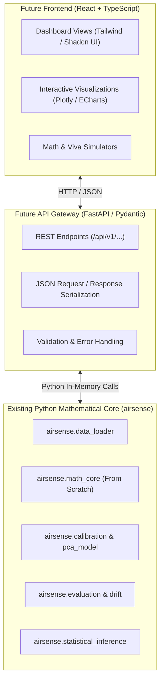

# AirSense: Frontend Integration Contract & API Specification

**Document Version**: 1.0.0 (Candidate Architecture for UI/UX Redesign)  
**Target Next Phase**: Modern Web Interface (React, TypeScript, Tailwind CSS, Vite) backed by a FastAPI Service  
**Current Backend Status**: Decoupled, stateless Python scientific computing core (`src/airsense/`)  
**Scope**: **Interface Specification & Contract Only** (Do not introduce Node.js, React, or FastAPI dependencies in the frozen Python engine).

---

## 1. Overview & Architectural Strategy

The next phase of the AirSense project is a modern UI/UX redesign. The goal is to provide a responsive, high-performance web dashboard while preserving the numerical integrity of the Python mathematical core.

### Architectural Blueprint:


### Core Architectural Principles:
1. **Zero Mathematical Duplication**: All linear algebra algorithms, SVD/PCA calculations, least-squares solves, hypothesis tests, and drift monitoring **must remain exclusively in the Python backend**. The frontend must never reimplement matrix operations or statistical algorithms in JavaScript or TypeScript.
2. **Stateless Operations**: The backend operates as a stateless computational engine. Intermediate datasets (such as `air_quality_supervised.csv`) are cached in memory or loaded on startup.
3. **Decoupled Contracts**: The frontend interacts strictly through well-defined JSON schemas with explicit typing, units, missing-value representations, and scientific qualifiers.

---

## 2. Modules That Must NOT Be Duplicated in Frontend Code

Under no circumstances should the frontend codebase implement custom numerical routines for:

| Python Module | Core Capabilities | Reason for Backend-Only Execution |
|---|---|---|
| [`airsense.math_core`](file:///e:/GitHub%20Projects/AirSense/src/airsense/math_core.py) | Gaussian elimination, $PA=LU$, RREF, Rank-Nullity, MGS QR, Jacobi symmetric diagonalization, SVD, Eckart-Young bounds | Strict floating-point parity with NumPy/SciPy IEEE 754 precision; educational viva verification tests validate these exact Python functions. |
| [`airsense.calibration`](file:///e:/GitHub%20Projects/AirSense/src/airsense/calibration.py) | Chronological splitting, `FeatureStandardizer` (zero leakage), `LinearCalibrationModel` QR solver | Preserves strict temporal ordering and avoids data leakage. |
| [`airsense.pca_model`](file:///e:/GitHub%20Projects/AirSense/src/airsense/pca_model.py) | Principal Component Regression, back-projected physical weights $\mathbf{w}_{\text{feature}} = D_{\sigma}^{-1} V_k \mathbf{w}_{\text{pca}}$ | High-dimensional singular vector projection and feature sensitivity translation. |
| [`airsense.evaluation`](file:///e:/GitHub%20Projects/AirSense/src/airsense/evaluation.py) | RMSE, MAE, $R^2$, Mean Bias Error, Durbin-Watson statistic ($DW = 0.2062$), monthly temporal rollups | Exact benchmark reproducibility matching `reports/experiment_results.csv`. |
| [`airsense.statistical_inference`](file:///e:/GitHub%20Projects/AirSense/src/airsense/statistical_inference.py) | Normal MLE, Bayesian MAP Ridge regression, Welch's $t$-test, One-Way ANOVA, power curve simulations | Exact Student's $t$, Snedecor's $F$, and $\chi^2$ distribution probability functions from SciPy. |

---

## 3. Data Representation Standards for UI Responses

All future API endpoints must follow these serialization standards:

### 3.1 Missing Values (`NaN` and Sentinel `-200`)
- **JSON Serialization**: Standard JSON has no native `NaN`. In all JSON responses, missing values must be serialized as `null`.
- **UI Presentation**: The frontend must render `null` sensor readings as `"N/A"` or `"--"`, with a badge indicating the reason (e.g., `"Station Power Outage (Coincident Dropout)"`).
- **Sentinel Exclusion**: The raw sentinel `-200` must **never** be transmitted to the frontend as a valid numeric measurement.

### 3.2 Engineering Units
Every numeric field transmitted to the UI must include its physical dimension or unit in the metadata schema:
- Sensor channels (`PT08.S1` to `PT08.S5`): Raw resistance or potential response ($\text{sensor response units}$).
- Target gas (`C6H6(GT)`): Micrograms per cubic meter ($\mu g/m^3$).
- Temperature (`T`): Degrees Celsius ($^\circ\text{C}$).
- Relative Humidity (`RH`): Percentage ($\%$).
- Absolute Humidity (`AH`): Density ($g/m^3$).
- Errors / Residuals / Bias: $\mu g/m^3$.
- Variance: Percentage of total variance ($\%$).

### 3.3 Timestamps
- All timestamps must be ISO 8601 strings: `"YYYY-MM-DDTHH:MM:SS"`.
- Time step: Exactly $1$ hour intervals (`2004-03-10T18:00:00` to `2005-04-04T14:00:00`).

### 3.4 Scientific Limitations & Validation Warnings
Whenever the UI displays metrics or drift charts, the response must include standard qualifier badges:
- **Autocorrelation Warning**: `"Hourly residuals exhibit strong positive serial correlation (Durbin-Watson = 0.2062, rho = 0.897). Standard OLS confidence intervals underestimate true variance."`
- **Drift Confounding Warning**: `"Apparent baseline drift is confounded with annual ambient weather oscillations (T swings 0-40C, AH swings 0.3-2.2 g/m3). Physical semiconductor drift is not chamber-isolated."`
- **Model Selection Qualifier**: `"Stated validation protocol strictly selected k*=8 (Full OLS). Lower test error at k=3 is a post-hoc observation of PCA shrinkage regularization against seasonal shifts."`

---

## 4. Proposed REST API Endpoint Specification

A future FastAPI adapter (`src/airsense/api/`) would expose the following endpoints:

### 4.1 Data & Audit Endpoints

#### `GET /api/v1/dataset/summary`
Returns dataset provenance, ingestion shape, timestamp boundaries, and missingness breakdown.
- **Python Backend Call**: `airsense.data_loader.load_raw_air_quality` $\to$ `airsense.data_loader.clean_air_quality`
- **Sample JSON Response**:
```json
{
  "provenance": {
    "source": "UCI Machine Learning Repository (ID 360)",
    "sampling_location": "Italian City Roadside Array",
    "temporal_range": {
      "start": "2004-03-10T18:00:00",
      "end": "2005-04-04T14:00:00",
      "total_hours": 9357
    }
  },
  "counts": {
    "raw_rows": 9357,
    "coincident_blackout_rows": 366,
    "supervised_usable_rows": 8991
  },
  "columns": [
    {
      "name": "C6H6(GT)",
      "category": "target",
      "unit": "ug/m3",
      "missing_count": 366,
      "missing_pct": 3.91,
      "valid_count": 8991
    },
    {
      "name": "PT08.S1(CO)",
      "category": "mox_sensor",
      "unit": "sensor_units",
      "missing_count": 366,
      "missing_pct": 3.91,
      "valid_count": 8991
    }
  ]
}
```

#### `GET /api/v1/dataset/rows?limit=100&offset=0`
Paginated access to the clean supervised dataset for the frontend Data Explorer table.

---

### 4.2 Linear Algebra Laboratory Endpoints

#### `POST /api/v1/math/matrix-system`
Computes Gaussian elimination, canonical RREF, pivot positions, and $PA = LU$ factorization for user-defined or preset matrices.
- **Python Backend Call**: `airsense.math_core.gaussian_elimination`, `rref`, `lu_factorize`, `matrix_rank`, `null_space`, `column_space`
- **Request Body**:
```json
{
  "matrix": [[2.0, 1.0, -1.0], [-3.0, -1.0, 2.0], [-2.0, 1.0, 2.0]],
  "target_vector": [8.0, -11.0, -3.0],
  "tolerance": 1e-10
}
```
- **Response Body**:
```json
{
  "solution": [2.0, 3.0, -1.0],
  "residual_norm": 4.44e-16,
  "rref_matrix": [[1.0, 0.0, 0.0], [0.0, 1.0, 0.0], [0.0, 0.0, 1.0]],
  "pivot_columns": [0, 1, 2],
  "rank": 3,
  "nullity": 0,
  "lu_factorization": {
    "P": [[0, 1, 0], [1, 0, 0], [0, 0, 1]],
    "L": [[1.0, 0.0, 0.0], [-0.6667, 1.0, 0.0], [0.6667, 5.0, 1.0]],
    "U": [[-3.0, -1.0, 2.0], [0.0, 0.3333, 0.3333], [0.0, 0.0, -1.0]],
    "error_norm": 2.22e-16
  }
}
```

#### `POST /api/v1/math/gram-schmidt`
Runs Classical vs. Modified Gram-Schmidt side-by-side to display numerical stability bar charts.
- **Python Backend Call**: `airsense.math_core.gram_schmidt_classical`, `airsense.math_core.gram_schmidt_modified`
- **Response Body**:
```json
{
  "cgs_orthogonality_loss": 1.88e-2,
  "mgs_orthogonality_loss": 2.66e-9,
  "stability_gain_factor": 7070000.0
}
```

---

### 4.3 PCA & Spectral Analysis Endpoints

#### `GET /api/v1/pca/spectral-decomposition`
Returns the complete eigenvalue spectrum, cumulative variance curve, and Eckart-Young reconstruction error profile.
- **Python Backend Call**: `airsense.math_core.compute_covariance`, `jacobi_eigenvalues_symmetric`, `pca_svd`, `low_rank_approximation`
- **Response Body**:
```json
{
  "components": [
    {"k": 1, "eigenvalue": 4.4712, "singular_value": 155.33, "var_pct": 55.89, "cum_var_pct": 55.89, "frob_error": 3.5288},
    {"k": 2, "eigenvalue": 1.7752, "singular_value": 97.87, "var_pct": 22.19, "cum_var_pct": 78.08, "frob_error": 1.7536},
    {"k": 3, "eigenvalue": 1.2768, "singular_value": 82.99, "var_pct": 15.96, "cum_var_pct": 94.04, "frob_error": 0.4768},
    {"k": 4, "eigenvalue": 0.1968, "singular_value": 32.58, "var_pct": 2.46, "cum_var_pct": 96.50, "frob_error": 0.2800},
    {"k": 5, "eigenvalue": 0.1208, "singular_value": 25.53, "var_pct": 1.51, "cum_var_pct": 98.01, "frob_error": 0.1592},
    {"k": 6, "eigenvalue": 0.0976, "singular_value": 22.95, "var_pct": 1.22, "cum_var_pct": 99.23, "frob_error": 0.0616},
    {"k": 7, "eigenvalue": 0.0368, "singular_value": 14.07, "var_pct": 0.46, "cum_var_pct": 99.69, "frob_error": 0.0248},
    {"k": 8, "eigenvalue": 0.0248, "singular_value": 11.56, "var_pct": 0.31, "cum_var_pct": 100.00, "frob_error": 0.0000}
  ],
  "covariance_condition_number": 1.80e2,
  "svd_condition_number": 1.89e4
}
```

---

### 4.4 Sensor Calibration & Model Benchmark Endpoints

#### `POST /api/v1/calibration/run`
Fits a user-configured calibration model (custom feature subset, choice of Full OLS vs. PCR with $k$ components) and returns partition metrics, scatter plot points, residual histograms, and back-projected feature weights.
- **Python Backend Call**: `airsense.calibration.chronological_split` $\to$ `airsense.calibration.LinearCalibrationModel` or `airsense.pca_model.PCACalibrationModel` $\to$ `airsense.evaluation.evaluate_predictions`
- **Request Body**:
```json
{
  "features": ["PT08.S1(CO)", "PT08.S2(NMHC)", "PT08.S3(NOx)", "PT08.S4(NO2)", "PT08.S5(O3)", "T", "RH", "AH"],
  "model_type": "PCR",
  "k_components": 3,
  "train_ratio": 0.6,
  "val_ratio": 0.2
}
```
- **Response Body**:
```json
{
  "model_configuration": {
    "model_type": "PCR",
    "k_components": 3,
    "feature_count": 8
  },
  "metrics": {
    "training": {"rmse": 1.9274, "mae": 1.3412, "r2": 0.9292, "mbe": 0.0000},
    "validation": {"rmse": 2.8258, "mae": 1.8805, "r2": 0.8876, "mbe": -0.4215},
    "test": {"rmse": 2.4146, "mae": 1.9375, "r2": 0.8626, "mbe": 0.8612}
  },
  "feature_sensitivities": [
    {"feature": "PT08.S1(CO)", "weight": 0.003412, "unit": "ug/m3 per sensor_unit"},
    {"feature": "PT08.S2(NMHC)", "weight": 0.018945, "unit": "ug/m3 per sensor_unit"}
  ],
  "diagnostics": {
    "durbin_watson": 0.2062,
    "autocorrelation_rho": 0.8969
  },
  "scientific_notice": {
    "validation_selected_model": "k*=8 (Full OLS, Val RMSE=2.0242)",
    "interpretation": "k=3 is a post-hoc regularized observation demonstrating out-of-time stability against sensor drift."
  }
}
```

#### `GET /api/v1/calibration/benchmark-matrix`
Returns the complete reproducible benchmark matrix ($k=1 \dots 8$) matching `reports/experiment_results.csv`.

---

### 4.5 Drift Monitoring & Temporal Quality Control

#### `GET /api/v1/drift/monthly-breakdown`
Returns monthly RMSE, MAE, $R^2$, and Mean Bias progression over the 13-month operational timeline.
- **Python Backend Call**: `airsense.evaluation.monthly_error_metrics`
- **Sample Item**:
```json
{
  "period": "2004-03",
  "observation_count": 510,
  "rmse": 0.9967,
  "mae": 0.7766,
  "r2": 0.9800,
  "mean_bias": 0.4437,
  "durbin_watson": 0.5332
}
```

---

### 4.6 Statistical Laboratory Endpoints

#### `POST /api/v1/statistics/clt`
Generates Monte Carlo sampling distributions from the real-world sensor data.
- **Python Backend Call**: `airsense.statistical_inference.simulate_clt`
- **Request Body**: `{"sample_size": 30, "num_samples": 2000, "seed": 42}`

#### `POST /api/v1/statistics/hypothesis-test`
Executes one-sample, Welch two-sample, ANOVA, or power simulations.
- **Python Backend Call**: `airsense.statistical_inference.one_way_anova`, `simulate_power_curve`

---

## 5. Recommended Future Architecture: React + FastAPI

When embarking on the UI/UX redesign, structure the repository cleanly:

```text
AirSense/
├── src/airsense/             # EXISTING PYTHON MATHEMATICAL ENGINE (FROZEN)
│   ├── math_core.py
│   ├── calibration.py
│   ├── pca_model.py
│   └── ...
│
├── api/                      # FUTURE FASTAPI ADAPTER (TO BE BUILT)
│   ├── main.py               # FastAPI app initialization & CORS middleware
│   ├── routes/               # Modular route handlers calling airsense.*
│   └── schemas/              # Pydantic models enforcing this contract
│
├── frontend/                 # FUTURE MODERN WEB UI (TO BE BUILT)
│   ├── src/
│   │   ├── components/       # UI elements (Cards, Tables, Tabs, Charts)
│   │   ├── views/            # Dashboard pages corresponding to Sections 1-8
│   │   └── api/              # Typed fetch clients calling FastAPI
│   ├── package.json
│   └── tsconfig.json
```

---

## 6. Verification Checklist for the Frontend Developer

When implementing the future frontend:
- [ ] Confirm that no linear algebra or statistical algorithm is rewritten in TypeScript.
- [ ] Ensure that `null` values are rendered as `"N/A"` with appropriate explanatory badges.
- [ ] Display the validation selection rule ($k^*=8$) alongside post-hoc observations ($k=3, 4$) to maintain academic integrity.
- [ ] Display the Durbin-Watson serial autocorrelation badge ($DW = 0.2062$) on all residual plots.
- [ ] Include the scientific disclaimer regarding sensor drift vs. ambient weather confounding on drift analysis pages.
